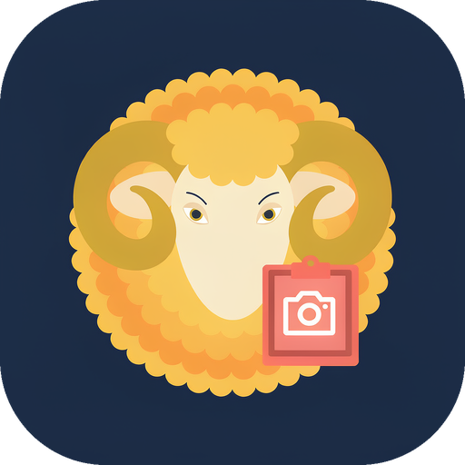
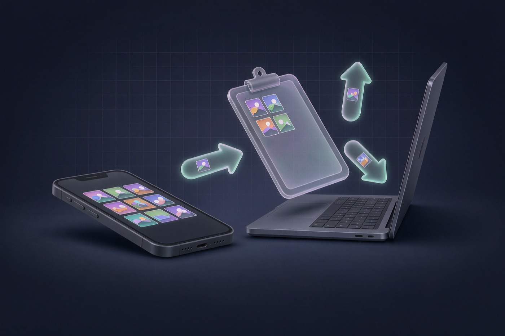
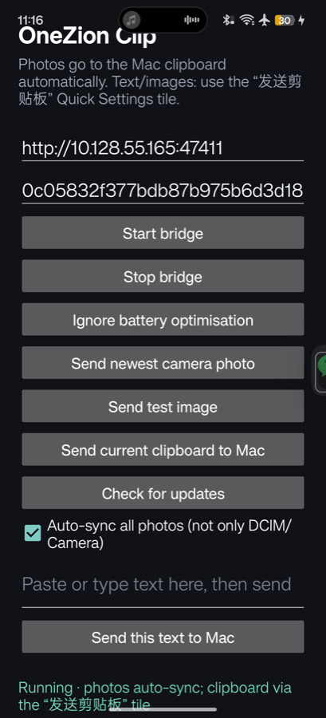
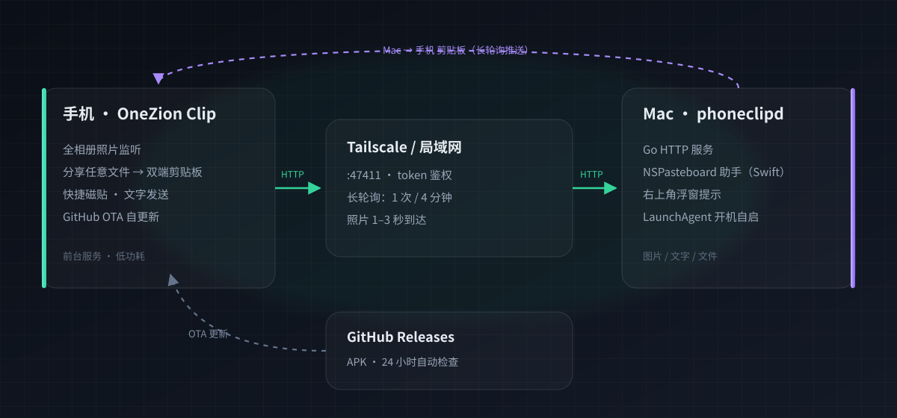

# PhoneClip



**手机拍的照片，自动出现在 Mac 剪贴板里。** 分享一个文件给 App，手机和 Mac 两端剪贴板同时拿到——不用微信文件传输助手，不压缩，不走第三方服务器。




## 能做什么

| 能力 | 怎么用 | 说明 |
|---|---|---|
| 照片自动进 Mac 剪贴板 | 拍完就行 | 全相册监听（截图、微信保存图也算），1–3 秒到达；也可切回「仅相机」 |
| 分享文件 → 双端剪贴板 | 系统分享菜单，或在 App 里点「选择文件 / 选择照片」 | 手机剪贴板是文件本身，Mac 剪贴板也是文件；多选支持批量 |
| 发当前剪贴板 | 快捷设置磁贴「发送剪贴板」 | 文字/图片/文件都可以；Android 13+ 禁止后台读剪贴板，所以是点一下 |
| 只保留音频 | 分享视频 → 「只保留音频」 | 无损抽轨（m4a），几秒完成，不上传视频 |
| 视频压缩 | 分享视频 → 「压缩到 720p 并发送」 | H.264 ~2.5 Mbps + 原音轨直拷；长视频会发热、耗时按分钟计 |
| 音频压缩 | 分享音频 → 「压缩音频并发送」 | AAC-LC 96 kbps，`-96k.m4a` |
| 转写（手机端） | 分享/选择音频或视频 → 「转写」 | OpenAI 兼容端点；文本存手机 `Download/PhoneClip/Transcripts`，可开关同步到 Mac |
| 在 App 里打一段字发过去 | App 内文本框 | 粘贴长文、链接、验证码都行 |
| 自动更新 | 无需操作 | 每 24h 检查 GitHub Release，弹通知，点一下安装 |
| 浏览手机文件（Sidecar） | 菜单栏 → 「手机文件…」 | 复用同一条连接，不需要 ADB；双击目录、选中下载到 `~/Downloads/PhoneClip` |

## 长这样

| 手机端 | Mac 端提示 |
|---|---|
|  |  |

> 手机端截图是 1.0 版界面；1.4 起的 Material You 界面待补真机截图。

## 怎么工作



- Android 端是前台服务：`MediaStore` 观察新照片，分享目标把文件拷进私有存储后用**自己的 `content://` URI** 写进剪贴板（这样别的 App 粘贴时系统才会授权）。
- 传输是一条 HTTP 请求，端口 `47411`，token 鉴权；**Tailscale 或同一局域网**都行。
- Mac 端是 `PhoneClip.app`：原生 Swift/AppKit 菜单栏 App，自带 HTTP 服务、剪贴板读写和浮窗提示，登录后由 LaunchAgent 自动启动。菜单里可以复制地址/Token、打开收到的照片或文件文件夹、改端口和 Token。
- 反向（Mac → 手机）用 4 分钟长轮询：没变化就一直挂着，有变化立刻返回。

## 安装

### Mac

macOS 13+，原生 App，不需要 Node / Electron，也不需要额外的运行时。

```bash
git clone https://github.com/onezion12344/phoneclip.git
cd phoneclip
./install-mac.sh
```

也可以直接从 [Releases](https://github.com/onezion12344/phoneclip/releases) 下载 `PhoneClip-<版本>.dmg`，拖进「应用程序」（自签 App，首次打开请右键 → 打开）；然后把 `install-mac.sh` 里那段 LaunchAgent 内容（或用 `launchctl`）配一次登录自启。

脚本会编译 `PhoneClip.app`（约 1.3 MB）装到 `/Applications`，注册登录自启，并打印：

```
Tailscale  http://100.x.y.z:47411
LAN        http://192.168.x.y:47411
token      xxxxxxxx
```

菜单栏会出现剪贴板图标；所有功能都在它的菜单里。用 DMG 手动安装时，打开「偏好设置…」点「启用开机启动」即可（不需要终端）。

### Android

1. 从 [Releases](https://github.com/onezion12344/phoneclip/releases) 下载 `PhoneClip.apk` 安装；
2. 打开 App，填上一步的地址和 token，点 **Start bridge**，允许「照片和视频」权限；
3. 控制中心编辑 → 添加「发送剪贴板」磁贴；
4. 设置 → 应用 → 自启动 → 允许 OneZion Clip；电池 → 耗电管理 → 允许后台活动。

也可以用 adb 一次配好：

```bash
adb shell am start -n ai.onezion.phoneclip/.MainActivity \
  --es server http://<mac-ip>:47411 --es token <token> --ez start true
```

## 使用

- **拍照/截图** → 什么都不用做，Mac 右上角会弹「照片已从手机复制」；
- **发文件** → 相册、文件管理器、微信里选「分享」→ OneZion Clip；也可以直接在 App 里点「选择文件…」（任意格式）或「选择照片…」；
- **发文字** → 复制后下拉点「发送剪贴板」磁贴，或在 App 文本框里输入；
- **转写 / 压缩** → 分享音频或视频后会弹出动作菜单：发送原样 / 只保留音频 / 压缩到 720p / 转写；也可以在 App 里「选择文件…」后选同样的动作。
- **相册范围** → App 里勾选「Auto-sync all photos」；关掉则只同步 `DCIM/Camera`；
- **浏览手机文件** → Mac 菜单栏 →「手机文件…」；第一次要在手机 App 里打开「所有文件访问」（Sidecar 才能读全盘）。

### 转写与压缩（手机端）

- 转写设置：App 的「转写」卡片里填 **Base URL / API Key / Model**（任何 OpenAI 兼容的 `/v1/audio/transcriptions`，云端或你自建的本地服务）。Key 只存在手机本地。
- 转写结果：手机 `Download/PhoneClip/Transcripts/`；打开「转写后同步文本到 Mac」会再写一份到 Mac 的转录文件夹（默认 `~/Documents/PhoneClip/Transcripts/`，可在菜单「偏好设置…」里改）。
- 视频转写会先无损抽音轨再上传转写；视频压缩用系统 `MediaCodec`（不打包 ffmpeg），目标 720p H.264；音轨只支持 AAC（mp4a）直拷，其他编码会被丢弃。

## 更新

```bash
./release.sh 1.4.0                      # 改版本号 + 构建
gh release create v1.4.0 build/PhoneClip.apk \
  --title "PhoneClip 1.4.0" --notes "..."
```

真机自测（侧车 / 转写 / 压缩）：`./selftest.sh [adb-serial]`（手机会被自动安装、配置并跑三项断言）。

手机端 24 小时内自动发现新版本；签名固定用同一把 debug keystore（`~/.android/debug.keystore`），换签名会导致覆盖安装失败。

## 资源占用

| 指标 | 数值 | 来源 |
|---|---|---|
| 空闲请求 | 1 次 / 4 分钟（`wait=240` 长轮询） | 代码 + 协议测试 |
| 静置 CPU / 内存 PSS / 照片延迟 | 待真机实测 | — |
| Mac App 安装体积 | 1.3 MB（原生 Swift/AppKit） | 实测 |
| Mac App 内存 | ≈72 MB RSS（含共享框架；Electron 同类通常 200 MB+） | 实测 |

常驻的真实耗电大头是 Tailscale 本身，不是这个 App。手机端的 CPU/PSS 与照片延迟数字要等真机跑过再补，这里不写估算。

## 已知限制

- **手机 → Mac 的剪贴板不会自动同步**：Android 13+ 禁止后台 App 读剪贴板，系统日志会直接写 `Denying clipboard access`；无障碍、旧 targetSdk、root/shell 在这台 ColorOS 16 上都被拒。所以做成了磁贴点一下。
- 微信等只接受文本/图片的输入框，粘不出「文件」，这是接收方的限制。
- 单次分享上限 200 MB。
- 转写需要手机能访问你配置的 OpenAI 兼容端点；完全离线的手机本地转写需要几百 MB 的模型，和「轻量」冲突，未内置。
- 视频压缩只输出 720p H.264；音频压缩暂只做「抽轨/直拷」，没有重编码为低码率。
- Sidecar 需要手机端开启「所有文件访问」，且只在你自己的局域网/Tailscale 内可见；`Android/data`、`Android/obb` 不暴露。
- Sidecar 只在手机服务运行时可用（前台服务被系统杀掉就暂时不可浏览）。
- 只有 Android；iOS 没有对应实现。
- ColorOS 的自启动开关不开放 adb，需要手动打开一次。

## 目录

```
phoneclip/
├── src/ai/onezion/phoneclip/   Android：服务、照片监听、分享、磁贴、OTA
├── res/                        Android 资源
├── AndroidManifest.xml
├── build.sh                    不用 Gradle 的构建脚本（aapt2 + d8 + apksigner）
├── deploy-phone.sh             adb 一键安装/配置/测试
├── release.sh                  发版：改版本号 → 构建 → 打印 gh 命令
├── mac-app/                    原生菜单栏 App（Swift/AppKit，自带 HTTP 服务）
├── install-mac.sh              编译 + 安装到 /Applications + 登录自启
└── docs/                       README 用的图
```

## 安全

- 所有接口都要 `X-PhoneClip-Token`，token 在安装时随机生成；
- 守护进程监听 `0.0.0.0` 是为了局域网内的第二台手机，token 之外的请求一律 403；
- 数据只在你自己的设备之间走，不经过任何第三方服务；唯一的联网是 GitHub Release 检查更新；
- 收到的照片除了进剪贴板，也会在 `~/Pictures/PhoneClip/日期/` 留一份副本，可自行删除。

---

目标设备：OnePlus Ace 3 Pro（ColorOS 16 / Android 16）、OnePlus Open（CPH2551）、macOS 15+。

验证状态：Mac 端协议测试 16 项全绿、DMG 冷启动与 OTA 链路实测；**手机端功能（侧车、转写、压缩、新界面）尚待在真机上回归**。
