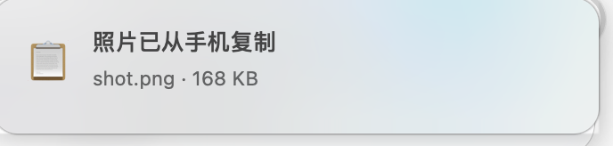

# PhoneClip

**手机拍的照片，自动出现在 Mac 剪贴板里。** 分享一个文件给 App，手机和 Mac 两端剪贴板同时拿到——不用微信文件传输助手，不压缩，不走第三方服务器。


## 能做什么

| 能力 | 怎么用 | 说明 |
|---|---|---|
| 照片自动进 Mac 剪贴板 | 拍完就行 | 全相册监听（截图、微信保存图也算），1–3 秒到达；也可切回「仅相机」 |
| 分享文件 → 双端剪贴板 | 系统分享菜单 → OneZion Clip | 手机剪贴板是文件本身，Mac 剪贴板也是文件；多选支持批量 |
| 发当前剪贴板 | 快捷设置磁贴「发送剪贴板」 | 文字/图片/文件都可以；Android 13+ 禁止后台读剪贴板，所以是点一下 |
| 在 App 里打一段字发过去 | App 内文本框 | 粘贴长文、链接、验证码都行 |
| 自动更新 | 无需操作 | 每 24h 检查 GitHub Release，弹通知，点一下安装 |

## 长这样

| 手机端 | Mac 端提示 |
|---|---|
|  |  |

## 怎么工作


- Android 端是前台服务：`MediaStore` 观察新照片，分享目标把文件拷进私有存储后用**自己的 `content://` URI** 写进剪贴板（这样别的 App 粘贴时系统才会授权）。
- 传输是一条 HTTP 请求，端口 `47411`，token 鉴权；**Tailscale 或同一局域网**都行。
- Mac 端的 `phoneclipd` 是 Go 写的守护进程，配一个 Swift 小工具读写 `NSPasteboard`；收到东西就放进剪贴板，并在右上角弹一张 1.7 秒的小卡片。
- 反向（Mac → 手机）用 4 分钟长轮询：没变化就一直挂着，有变化立刻返回。

## 安装

### Mac

需要 Go 与 Xcode Command Line Tools（`swiftc`）。

```bash
git clone https://github.com/onezion12344/phoneclip.git
cd phoneclip
./install-mac.sh
```

脚本会编译守护进程与剪贴板助手、装成 LaunchAgent（开机自启），并打印：

```
Tailscale  http://100.x.y.z:47411
LAN        http://192.168.x.y:47411
token      xxxxxxxx
```

### Android

1. 从 [Releases](https://github.com/onezion12344/phoneclip/releases) 下载 `PhoneClip.apk` 安装；
2. 打开 App，填上一步的地址和 token，点 **Start bridge**，允许「照片和视频」权限；
3. 控制中心编辑 → 添加「发送剪贴板」磁贴；
4. 设置 → 应用 → 自启动 → 允许 OneZion Clip；电池 → 耗电管理 → 允许后台活动。

也可以用 adb 一次配好：

```bash
adb shell am start -n ai.onezion.phoneclip/.MainActivity \
  --es server http://<mac-ip>:47411 --es token <token> --ez start true
```

## 使用

- **拍照/截图** → 什么都不用做，Mac 右上角会弹「照片已从手机复制」；
- **发文件** → 相册、文件管理器、微信里选「分享」→ OneZion Clip；
- **发文字** → 复制后下拉点「发送剪贴板」磁贴，或在 App 文本框里输入；
- **相册范围** → App 里勾选「Auto-sync all photos」；关掉则只同步 `DCIM/Camera`。

## 更新

```bash
./release.sh 1.4.0                      # 改版本号 + 构建
gh release create v1.4.0 build/PhoneClip.apk \
  --title "PhoneClip 1.4.0" --notes "..."
```

手机端 24 小时内自动发现新版本；签名固定用同一把 debug keystore（`~/.android/debug.keystore`），换签名会导致覆盖安装失败。

## 资源占用（OnePlus Ace 3 Pro 实测）

| 指标 | 数值 |
|---|---|
| 静置 CPU | 0.05 秒 / 2 分钟（≈0.04% 单核） |
| 内存 PSS | ≈14 MB |
| 空闲请求 | 1 次 / 4 分钟（长轮询） |
| 照片延迟 | 1–3 秒 |

常驻的真实耗电大头是 Tailscale 本身，不是这个 App。

## 已知限制

- **手机 → Mac 的剪贴板不会自动同步**：Android 13+ 禁止后台 App 读剪贴板，系统日志会直接写 `Denying clipboard access`；无障碍、旧 targetSdk、root/shell 在这台 ColorOS 16 上都被拒。所以做成了磁贴点一下。
- 微信等只接受文本/图片的输入框，粘不出「文件」，这是接收方的限制。
- 单次分享上限 200 MB。
- 只有 Android；iOS 没有对应实现。
- ColorOS 的自启动开关不开放 adb，需要手动打开一次。

## 目录

```
phoneclip/
├── src/ai/onezion/phoneclip/   Android：服务、照片监听、分享、磁贴、OTA
├── res/                        Android 资源
├── AndroidManifest.xml
├── build.sh                    不用 Gradle 的构建脚本（aapt2 + d8 + apksigner）
├── deploy-phone.sh             adb 一键安装/配置/测试
├── release.sh                  发版：改版本号 → 构建 → 打印 gh 命令
├── mac/                        Mac 守护进程（Go + Swift 剪贴板助手 + 浮窗）
├── install-mac.sh              安装/卸载/状态
└── docs/                       README 用的图
```

## 安全

- 所有接口都要 `X-PhoneClip-Token`，token 在安装时随机生成；
- 守护进程监听 `0.0.0.0` 是为了局域网内的第二台手机，token 之外的请求一律 403；
- 数据只在你自己的设备之间走，不经过任何第三方服务；唯一的联网是 GitHub Release 检查更新；
- 收到的照片除了进剪贴板，也会在 `~/Pictures/PhoneClip/日期/` 留一份副本，可自行删除。

---

测试环境：OnePlus Ace 3 Pro（ColorOS 16 / Android 16）、OnePlus Open（CPH2551）、macOS 15+。
